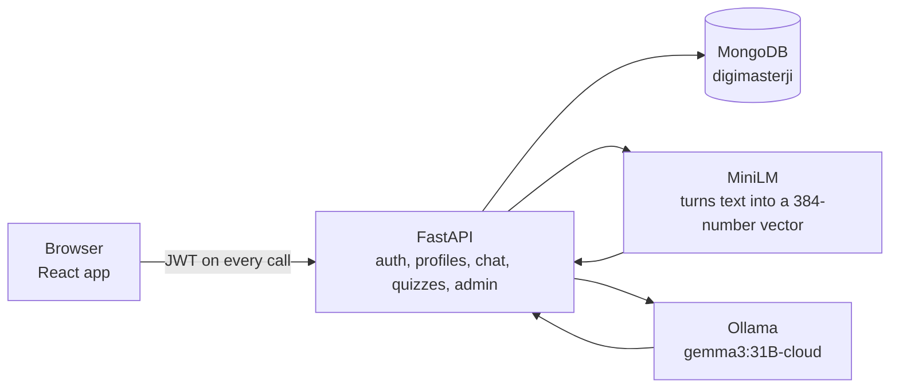
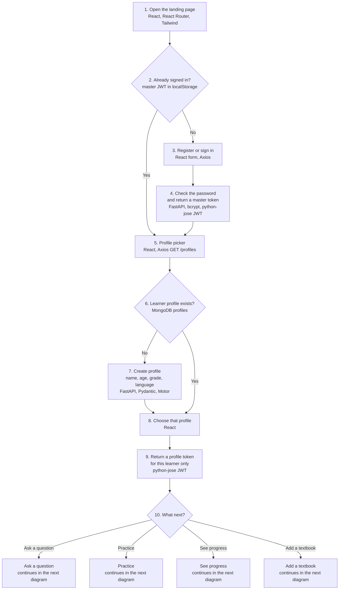
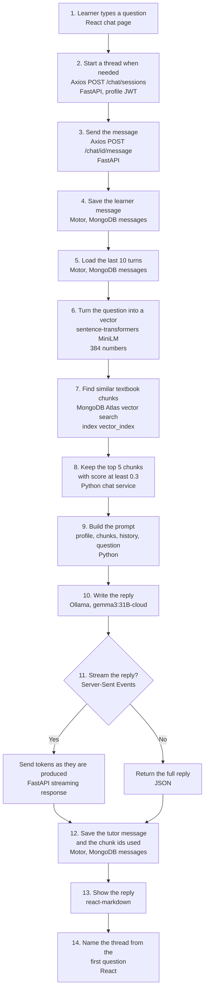
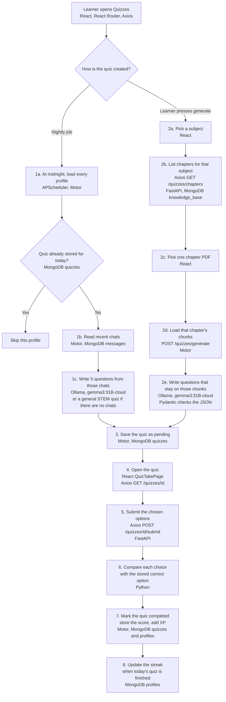
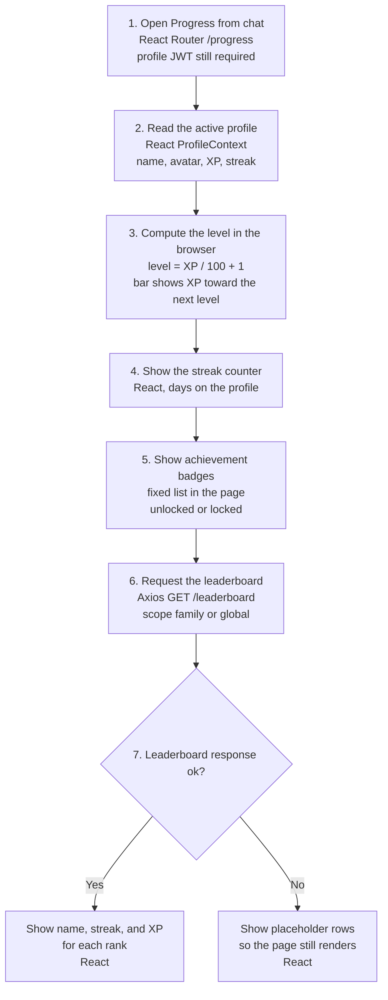
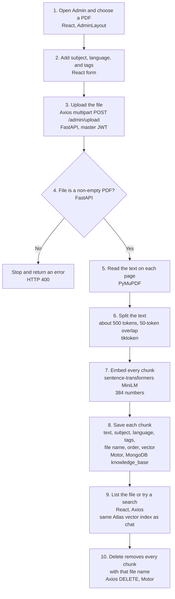
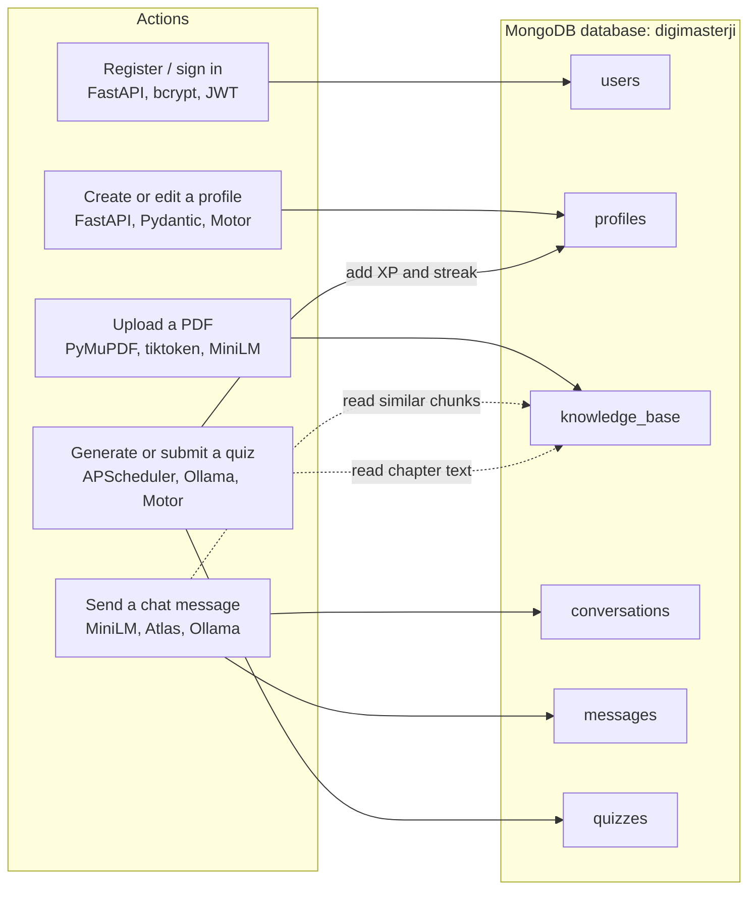

# DigiMasterJi system architecture

This page is the execution map of DigiMasterJi. Read the diagrams from top to bottom. Each number is one step the system actually takes.

DigiMasterJi is a multilingual STEM tutor. A parent or teacher has one account and creates a profile for each learner. The learner types a question. The backend searches uploaded textbook pages, then asks Gemma (through Ollama) to answer in that learner's language. The same textbook text is later used to build quizzes. Scores update XP and the study streak.

| Piece | Role in the flow |
| --- | --- |
| React app | Screens for sign-in, profiles, chat, quizzes, progress, and textbook upload |
| FastAPI | Checks the token, runs the step, and returns JSON |
| MongoDB | Stores accounts, profiles, chats, quizzes, and textbook chunks |
| MiniLM | Builds the vector used to find similar textbook chunks |
| Ollama / Gemma | Writes the tutor reply and the quiz questions |

Two tokens are used. The **master token** belongs to the parent or teacher and can manage profiles and textbooks. The **profile token** belongs to one learner and is required for chat and quizzes, so one child cannot open another child's chats.

---

## 1. From the landing page to a lesson

Registration stores a bcrypt password hash in `users`. Sign-in returns an access token and a refresh token. The browser keeps both and asks for a new access token before the old one expires. Choosing a profile calls `POST /profiles/{id}/access` and stores the profile token. Chat and quiz requests send that profile token.

---

## 2. Ask a question

This continues the **Ask a question** branch. One PDF must already be in the knowledge base, or step 8 has no textbook text to attach.

Step 9 puts four things in the prompt:

1. The learner's name, age, grade, and preferred language. Gemma is told to answer in that language, in simple steps, with an everyday example.
2. The textbook chunks kept in step 8, trimmed to about 1,500 tokens.
3. The recent messages from step 5.
4. The new question.

If step 8 keeps nothing, Gemma still answers, but the prompt has no textbook passage to follow.

---

## 3. Practice

This continues the **Practice** branch. A quiz is created on a schedule, or the learner builds one from a chapter. Both paths end on the same answer screen.

The midnight job also runs once about a minute after the server starts, unless `SKIP_STARTUP_QUIZ` is set. A quiz has 5 to 10 multiple-choice questions. Each question stores the correct option. The learner's choice is written onto the question at submit time.

---

## 4. See progress

This continues the **See progress** branch. XP and the streak were written when a quiz was submitted. This page reads them and draws the level.

---

## 5. Add a textbook

This continues the **Add a textbook** branch. Chat and chapter quizzes can use a chapter only after this flow stores it. One PDF is one chapter. The parent or teacher uses the master token, not the learner token.

Search from the admin screen uses the same vector index as the tutor. It is a way to check that a chapter can be found before a learner asks about it.

---

## 6. Where each step writes

| Collection | What one record holds |
| --- | --- |
| `users` | Parent or teacher account and password hash |
| `profiles` | Learner name, age, grade, language, XP, streak, badges |
| `knowledge_base` | One textbook chunk, its labels, and its 384-number vector |
| `conversations` | One chat thread: title, subject, message count |
| `messages` | One turn: who spoke, the text, and which chunks were used |
| `quizzes` | Questions, correct answers, status, score, XP, and date |

Atlas needs a vector index named `vector_index` on `knowledge_base.vector_embedding`. Without that index, step 7 of the chat flow cannot find textbook pages.
