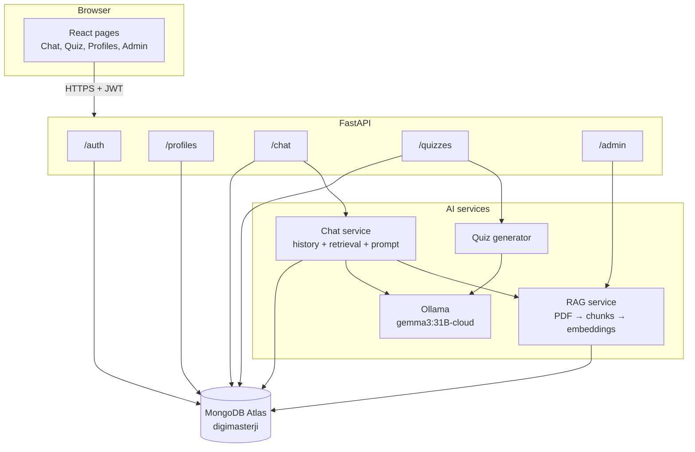
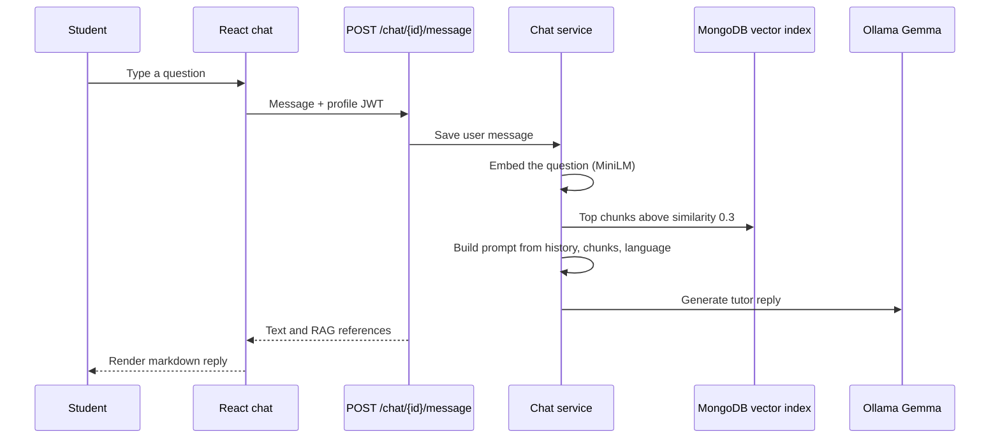
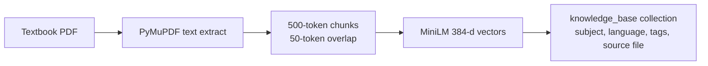
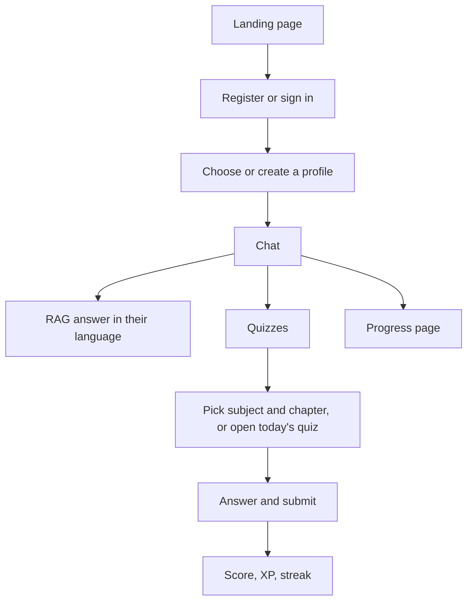

# DigiMasterJi

DigiMasterJi is an AI-powered multilingual STEM tutor for Indian students. A parent or teacher owns one master account and creates Netflix-style learner profiles. Each learner chats with a tutor that answers in their language, grounded in uploaded textbook PDFs, then practices with generated quizzes, streaks, and XP.

---

## Repository layout

```
ca3/
├── digimasterji-frontend-main/Frontend/   React + Vite web app
└── digimasterji-backend-main-app/         FastAPI API + AI services
    └── app/
        ├── main.py                        App entry, CORS, scheduler
        ├── routers/                       HTTP endpoints
        ├── services/                      RAG, LLM, chat, quizzes
        ├── database/                      MongoDB access
        ├── models/                        Pydantic schemas
        └── utils/security.py              Passwords and JWT
```

Default local URLs:

| Piece | URL |
| --- | --- |
| Frontend (Vite) | `http://localhost:5173` |
| Backend (Uvicorn) | `http://localhost:8000` |
| API docs | `http://localhost:8000/docs` |
| Ollama | `http://localhost:11434` |

The frontend calls `VITE_API_URL`, or `http://localhost:8000` when that variable is unset.

---

## Tech stack

### Frontend

| Layer | Choice |
| --- | --- |
| UI | React 19, React Router 7 |
| Build | Vite 7, Tailwind CSS 4 |
| HTTP | Axios, with JWT refresh interceptors |
| Motion / icons | Framer Motion, Lucide |
| Markdown replies | react-markdown |

### Backend

| Layer | Choice |
| --- | --- |
| API | FastAPI, Uvicorn, Pydantic |
| Database | MongoDB via Motor (`digimasterji` database) |
| Vector search | MongoDB Atlas `$vectorSearch` (`vector_index` on `vector_embedding`) |
| Auth | JWT (`python-jose`, HS256), bcrypt (`passlib`) |
| LLM | Ollama, default model `gemma3:31B-cloud` |
| Embeddings | `sentence-transformers/all-MiniLM-L6-v2` (384 dimensions) |
| PDF parsing | PyMuPDF |
| Chunking | ~500 tokens, 50-token overlap, counted with tiktoken (`cl100k_base`) |
| Scheduler | APScheduler (daily quizzes at midnight) |

The marketing copy on the landing page mentions ChromaDB. The running knowledge base is MongoDB Atlas Vector Search, not a separate Chroma store.

---

## Architecture



### Request path for a question



### Knowledge ingestion



An uploaded PDF is treated as one textbook chapter. Quiz generation later reads that chapter’s stored chunks.

---

## How the system works

### Accounts and profiles

Registration creates a **master account** (parent or teacher): email, Indian mobile number (`+91XXXXXXXXXX`), full name, and a password of at least 8 characters. Passwords are bcrypt-hashed. Login returns a short-lived access token and a refresh token. The frontend stores both in `localStorage` and refreshes the access token before it expires.

A master account can create several **student profiles**. Each profile has a name, age (5–18), grade (`1st`–`12th`), preferred language, avatar, and gamification stats. Opening a profile calls `POST /profiles/{id}/access` and receives a **profile token**. Chat and quizzes require that profile token, so one child’s session cannot read another child’s conversations.

Supported profile languages: Hindi, English, Bengali, Tamil, Telugu, Marathi, Gujarati, Kannada, Malayalam, Punjabi, Odia, Assamese, and Urdu.

### Tutor chat (RAG)

1. The student starts or resumes a conversation (`/chat/sessions`).
2. A message is saved, then the chat service loads the last 10 messages (configurable).
3. The question is embedded and searched against `knowledge_base` with Atlas `$vectorSearch`. Defaults: 5 chunks, minimum score 0.3, about 1,500 tokens of retrieved context.
4. The system prompt tells Gemma to answer in the student’s language, use simple rural-India examples, and explain step by step.
5. The reply can be returned as one JSON body or streamed as Server-Sent Events.

Conversation titles are derived on the client from the first message.

### Quizzes and progress

Two quiz paths exist:

- **Chapter quizzes.** The student picks a subject and a textbook PDF already in the knowledge base. `POST /quizzes/generate` writes a new quiz from that chapter’s chunks. The model is instructed to stay on the chapter text.

Submitting answers scores the quiz, marks it completed, and awards XP. Streak state is exposed at `GET /quizzes/streak/check`. The progress page (`/progress`) shows level (100 XP per level), badges, and a family or global leaderboard. The leaderboard UI calls `GET /leaderboard`; that route is not implemented on the backend, so the page falls back to sample rows when the call fails.

### Admin knowledge base

Any logged-in master user can open `/admin` (the routes are guarded by login, not by a separate admin role). From there they can:

- Upload a PDF with subject, language, and tags
- List documents and delete one by filename (all of its chunks)
- Run a semantic search to inspect retrieval
- View chunk statistics and RAG configuration

Subjects: Physics, Chemistry, Biology, Mathematics, General Science, Environmental Science.

---

## User workflows

### Learner



1. Open the landing page and register or sign in.
2. Select a profile, or create one with age, grade, language, and avatar.
3. Type a question in chat and read the markdown answer.
4. Open Quizzes, pick a subject and an uploaded chapter, generate a quiz, and submit answers.
5. Open Progress to see XP, level, streak, and badges.

### Parent or teacher

1. Register the master account with email and phone.
2. Create one profile per child.
3. Switch profiles from the profile picker. Each switch issues a new profile token.
4. Edit or delete a profile. Deleting a profile removes that learner’s access path.
5. Upload textbooks from the admin area so chat and chapter quizzes have source material.

### Content admin

1. Sign in with a master account.
2. Go to Admin → Upload and attach a chapter PDF, subject, and language.
3. Wait for parse, chunk, and embed (the client allows up to two minutes).
4. Confirm the file on Documents, or try a query on Vector Search.
5. Delete a file if the textbook should leave the knowledge base.

---

## Frontend routes

| Path | Who | Purpose |
| --- | --- | --- |
| `/` | Public | Landing page |
| `/login`, `/register` | Logged out | Master account auth |
| `/profiles` | Logged in | Pick a learner |
| `/profiles/create`, `/profiles/:id/edit` | Logged in | Create or edit a profile |
| `/chat` | Profile session | Tutor chat |
| `/quiz`, `/quiz/:quizId` | Profile session | Quiz list and attempt |
| `/progress` | Profile session | XP, badges, leaderboard UI |
| `/admin` | Logged in | Knowledge-base dashboard |
| `/admin/upload` | Logged in | PDF ingestion |
| `/admin/documents` | Logged in | List and delete documents |
| `/admin/search` | Logged in | Try vector search |

`PrivateRoute` checks `access_token` in `localStorage`. Logged-in users who hit login or register are sent to `/profiles`.

React context wraps the app in this order: `AuthProvider` → `ProfileProvider`.

---

## API surface

| Method | Path | Auth | Role |
| --- | --- | --- | --- |
| `GET` | `/`, `/health` | None | Liveness |
| `POST` | `/auth/register` | None | Create master account |
| `POST` | `/auth/login` (and alias) | None | Login |
| `POST` | `/auth/refresh` | Refresh token | New access token |
| `GET` | `/profiles` | Master JWT | List profiles |
| `POST` | `/profiles` | Master JWT | Create profile |
| `GET/PUT/DELETE` | `/profiles/{id}` | Master JWT | Read, update, delete |
| `POST` | `/profiles/{id}/access` | Master JWT | Issue profile token |
| `POST/GET` | `/chat/sessions` | Profile JWT | Start or list chats |
| `GET/PUT/DELETE` | `/chat/{id}` | Profile JWT | Conversation metadata |
| `GET` | `/chat/{id}/history` | Profile JWT | Messages |
| `POST` | `/chat/{id}/message` | Profile JWT | RAG reply, optional stream |
| `GET` | `/quizzes/pending`, `/quizzes/today` | Profile JWT | Available quizzes |
| `GET` | `/quizzes/chapters` | Profile JWT | Textbook chapters by subject |
| `GET` | `/quizzes/{id}` | Profile JWT | Questions |
| `POST` | `/quizzes/{id}/submit` | Profile JWT | Score and XP |
| `GET` | `/quizzes/streak/check` | Profile JWT | Streak status |
| `POST` | `/quizzes/generate` | Profile JWT | Chapter quiz |
| `POST` | `/admin/upload` | Master JWT | Ingest PDF |
| `POST` | `/admin/search` | Master JWT | Vector search |
| `GET` | `/admin/documents`, `/admin/stats`, `/admin/rag-info` | Master JWT | Inspect knowledge base |
| `DELETE` | `/admin/documents/{filename}` | Master JWT | Remove a document |

---

## Data model

Database name: `digimasterji`.

| Collection | Holds |
| --- | --- |
| `users` | Master accounts, hashed passwords, settings |
| `profiles` | Learners, language, grade, gamification |
| `conversations` | Chat threads, title, subject tag, message count |
| `messages` | Role, text, optional translation, RAG references |
| `quizzes` | Questions, options, correct answer, status, score, XP, date |
| `knowledge_base` | Chunk text, subject, language, tags, source file, 384-d embedding |

---

## Configuration

Set these in the backend environment and in the frontend `.env`. Do not commit real secrets.

| Variable | Used for |
| --- | --- |
| `MONGODB_URI` | MongoDB Atlas connection |
| `SECRET_KEY`, `ALGORITHM` | JWT signing (default algorithm `HS256`) |
| `ACCESS_TOKEN_EXPIRE_MINUTES`, `REFRESH_TOKEN_EXPIRE_DAYS` | Token lifetime (defaults 30 minutes and 7 days) |
| `OLLAMA_BASE_URL`, `OLLAMA_MODEL` | LLM (`http://localhost:11434`, `gemma3:31B-cloud`) |
| `CHAT_HISTORY_LIMIT`, `RAG_CHUNKS_LIMIT`, `RAG_MIN_SCORE`, `RAG_MAX_CONTEXT_TOKENS` | Retrieval window |
| `LLM_TEMPERATURE`, `LLM_MAX_TOKENS` | Generation (defaults 0.7 and 1024) |
| `SKIP_STARTUP_QUIZ` | Skip the quiz job that runs shortly after boot |
| `VITE_API_URL` | Frontend API base URL |

Atlas needs a vector search index named `vector_index` on `knowledge_base.vector_embedding` (384 dimensions) or retrieval returns no chunks.

---

## Run locally

Backend (from `digimasterji-backend-main-app`):

```bash
pip install -r requirements.txt
uvicorn app.main:app --reload --port 8000
```

Ollama must be running with the configured Gemma model available. The first RAG call downloads the embedding model weights.

Frontend (from `digimasterji-frontend-main/Frontend`):

```bash
npm install
npm run dev
```
